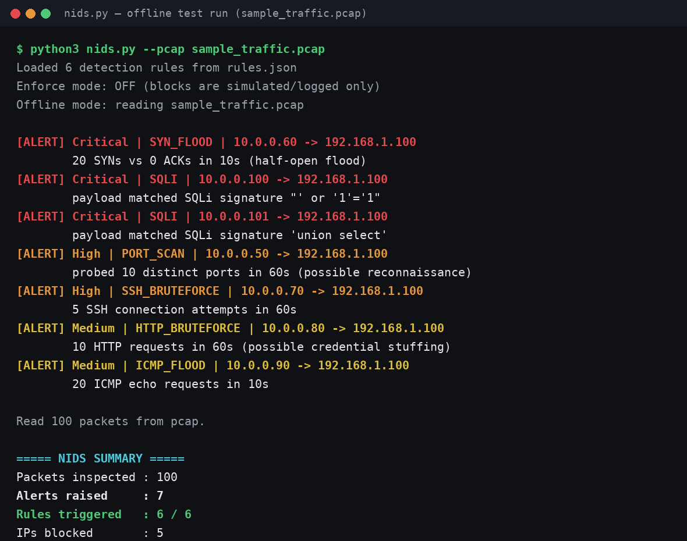
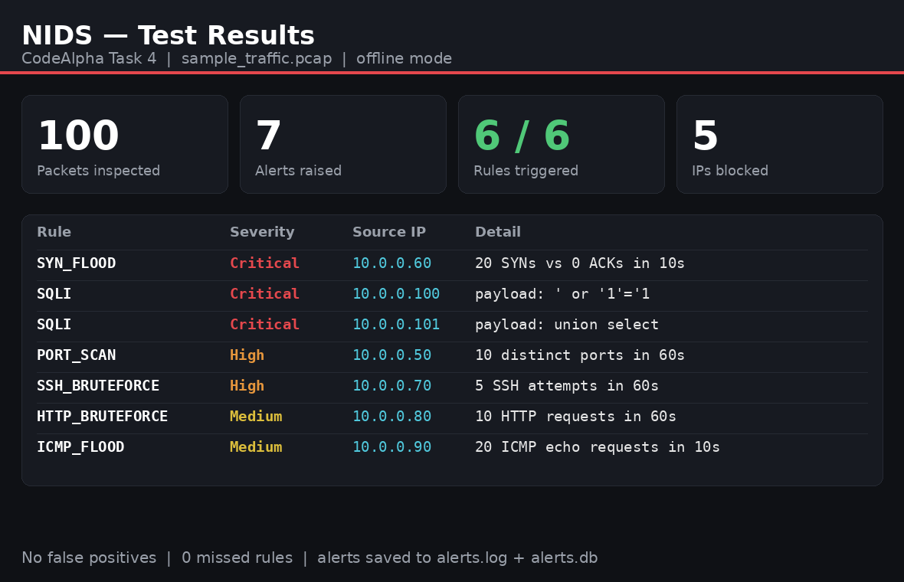

# CodeAlpha — Task 4: Network Intrusion Detection System (NIDS)

A Python-based network intrusion detection system. It watches network
traffic, matches it against detection rules, raises alerts, blocks the
offending IP, and shows everything on a dashboard.

> **Ethics:** run this only on your own network, your own lab, or traffic
> you have permission to inspect. Never monitor someone else's network.

## What is a NIDS?

A Network Intrusion Detection System sits on a network and watches the
traffic flowing past it. When it sees a known attack pattern — a port scan,
a flood of fake connection requests, someone guessing passwords — it raises
an alert so a human (or an automated response) can act. Real tools that do
this are **Snort** and **Suricata**; this project rebuilds the same idea in
Python so you can see how it works inside.

## Architecture

```
packets (live interface or .pcap file)
        |
        v
   nids.py  ── rules.json ──> detection engine (sliding windows)
        |                          |
        | alerts                   | High / Critical
        v                          v
  console + alerts.log       blocked_ips.txt
  + alerts.db (SQLite)       (+ iptables with --enforce)
        |
        v
  dashboard.py  ──>  dashboard.html (standalone, open in a browser)
```

## Files

| File | What it is |
|---|---|
| `nids.py` | The IDS itself: capture, rules engine, alerts, response |
| `rules.json` | 6 detection rules (id, name, severity, thresholds) |
| `generate_sample_traffic.py` | Builds `sample_traffic.pcap` (normal + attack traffic) |
| `sample_traffic.pcap` | Test traffic — no root needed to try the NIDS |
| `dashboard.py` | Reads `alerts.db`, builds a standalone HTML dashboard |
| `test-run.png` | Screenshot: terminal test run (7 alerts + summary) |
| `test-summary.png` | Screenshot: test results summary card |
| `snort-setup.md` | How to install Snort + the equivalent Snort rules |
| `requirements.txt` | `scapy>=2.5.0` |
| `README.md` | This file |
| `alerts.log` / `alerts.db` / `blocked_ips.txt` / `dashboard.html` | Created when you run the NIDS |

## Detection rules (`rules.json`)

| Rule | Severity | What it catches |
|---|---|---|
| `PORT_SCAN` | High | One IP probing ≥ 10 distinct ports in 60 s (reconnaissance) |
| `SYN_FLOOD` | Critical | ≥ 20 SYNs with almost no ACKs in 10 s (DoS) |
| `SSH_BRUTEFORCE` | High | ≥ 5 connection attempts to port 22 in 60 s |
| `HTTP_BRUTEFORCE` | Medium | ≥ 10 HTTP requests (incl. POST /login) in 60 s |
| `SQLI` | Critical | Payload contains `' OR '1'='1`, `UNION SELECT`, `DROP TABLE`, … |
| `ICMP_FLOOD` | Medium | ≥ 20 ping requests in 10 s (flood / ping sweep) |

To add a rule, add an entry to `rules.json` and the matching check in
`nids.py` — the rule file is data, the engine is generic.

## How to run it

### 1. Install the dependency

```bash
pip install -r requirements.txt
```

### 2. Offline mode (no root needed — the recommended way to test)

```bash
# Build the sample traffic (normal + attacks):
python3 generate_sample_traffic.py

# Run the NIDS against it:
python3 nids.py --pcap sample_traffic.pcap
```

You should see 6 alerts — one per rule — and the attacking IPs land in
`blocked_ips.txt`. Expected results:

| Attacker | Alert | Severity |
|---|---|---|
| `10.0.0.50` | PORT_SCAN | High |
| `10.0.0.60` | SYN_FLOOD | Critical |
| `10.0.0.70` | SSH_BRUTEFORCE | High |
| `10.0.0.80` | HTTP_BRUTEFORCE | Medium |
| `10.0.0.100` | SQLI (`' OR '1'='1`) | Critical |
| `10.0.0.101` | SQLI (`UNION SELECT`) | Critical |
| `10.0.0.90` | ICMP_FLOOD | Medium |

### 3. Live mode (needs root)

```bash
sudo python3 nids.py --iface eth0 --count 200
```

### 4. Dashboard

```bash
python3 dashboard.py
# open dashboard.html in any browser — no server needed
```

### 5. Real blocking (optional, needs root + iptables)

By default the NIDS only **simulates** the block: it writes the IP to
`blocked_ips.txt` and logs the action. To really drop the traffic:

```bash
sudo python3 nids.py --pcap sample_traffic.pcap --enforce
```

## Test results

Offline run against `sample_traffic.pcap` — 100 packets, 7 alerts, all 6
rules triggered, 5 IPs blocked, no false positives.





## How the detection works

- **Sliding windows:** for each source IP the engine keeps timestamps of
  interesting events (SYNs, port probes, HTTP requests, pings). Events older
  than the rule's window are dropped, so a slow trickle never trips a rule
  but a burst does.
- **Signature matching:** every TCP payload is lower-cased and checked
  against the SQL injection signatures in `rules.json`.
- **Alert cooldown:** the same (rule, source IP) pair alerts at most once
  per 60 seconds, so one attack does not flood the log with duplicates.
- **Response:** only High/Critical alerts trigger a block, and each IP is
  blocked once (the blocklist is de-duplicated).

## Snort

See [`snort-setup.md`](snort-setup.md) for installing Snort on Ubuntu/Kali
and the equivalent Snort rules for all six detections, plus how to replay
`sample_traffic.pcap` through Snort.

## What I learned

- How packets are structured (IP/TCP/UDP/ICMP) and how to read them.
- How real attacks look on the wire: scans, floods, brute force, injection.
- The full IDS pipeline: capture → detect → alert → respond → visualise.
- That detection is a trade-off: thresholds too low = false alarms,
  too high = missed attacks.
